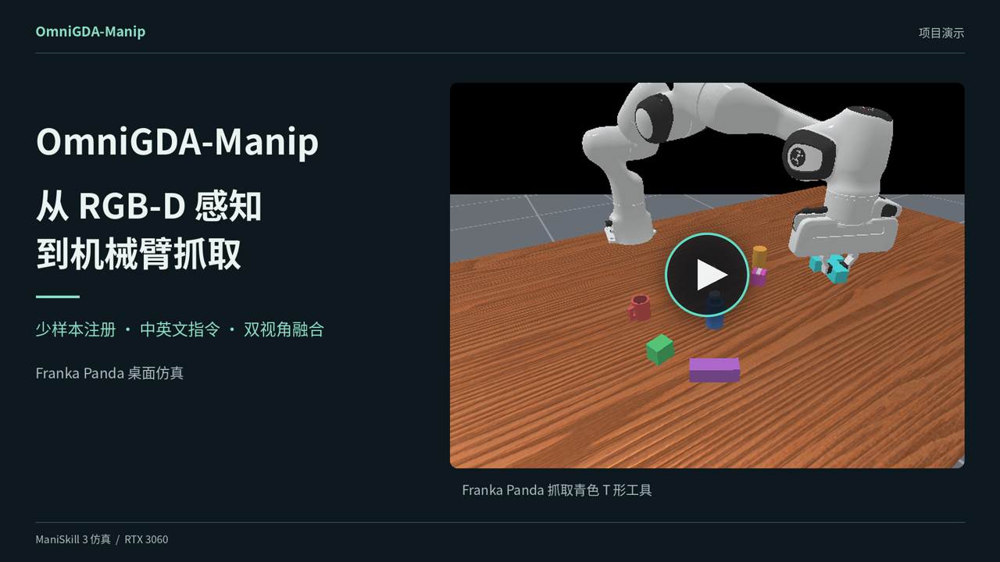
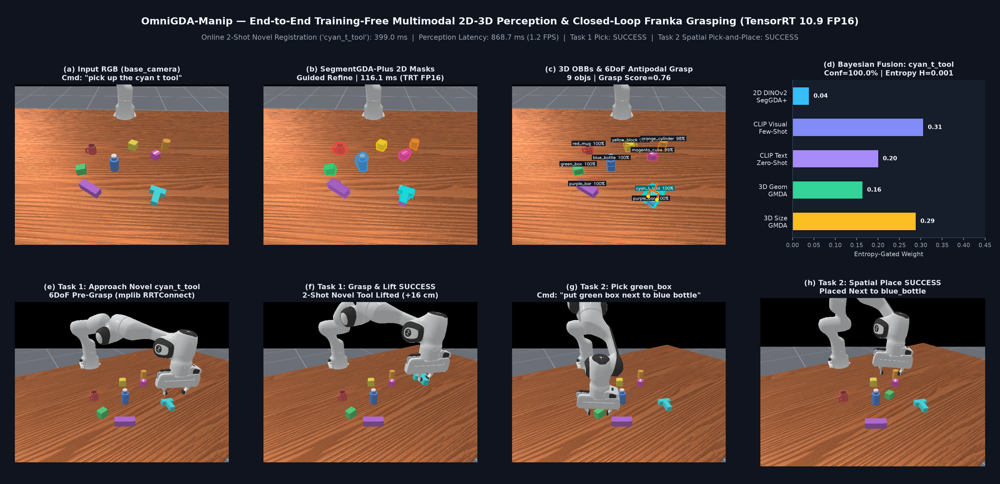
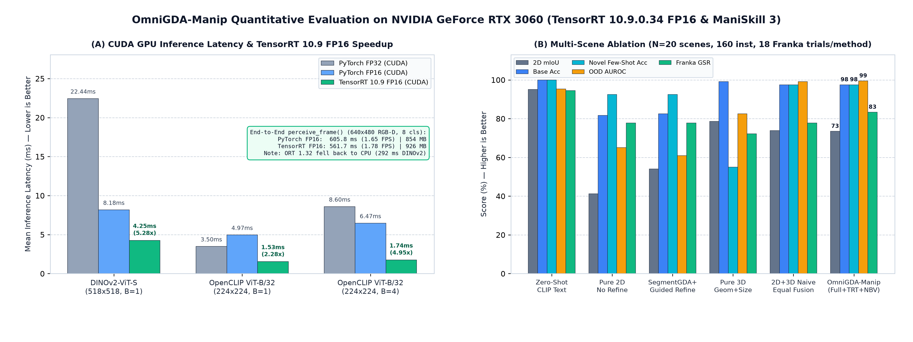

# OmniGDA-Manip

<p align="center">
  
  
  
  
  
  
</p>

**OmniGDA-Manip** is a **training-free, multimodal 2D–3D few-shot & open-vocabulary robotic perception, active Next-Best-View (NBV), and 6DoF manipulation system** built end-to-end on **DINOv2**, **OpenCLIP**, **TensorRT 10.9 FP16**, **ManiSkill 3**, and **ROS 2 Jazzy**.

Given just **2–3 RGB-D support templates** of a brand-new unseen object (such as a custom cyan T-shaped tool), OmniGDA-Manip registers it online in **~340–407 ms with zero gradient updates**, localizes it in cluttered tabletop scenes via **entropy-gated Bayesian 2D–3D Gaussian Mixture Discriminant Analysis**, resolves bilingual (**English / Chinese**) spatial instructions, triggers **active multi-view ICP NBV** when uncertain, and executes collision-free **6DoF antipodal grasping** on a Franka Panda arm.

## Demo Video

[](https://github.com/wavachao/omnigda-manip/raw/main/docs/media/OmniGDA-Manip-Demo.mp4)

> **End-to-End ManiSkill 3 + RTX 3060 TensorRT FP16 Demo (1080p, 44s)** — Click the preview above to watch/download [`docs/media/OmniGDA-Manip-Demo.mp4`](docs/media/OmniGDA-Manip-Demo.mp4):
> 1. **2-Shot Online Novel Registration** (`cyan_t_tool`, `101 ms`, zero gradient updates)
> 2. **English Pick Task** (`"pick up the cyan t tool"` — single-view localization & 15.8 cm lift)
> 3. **Active Multi-View NBV** (`base_camera` + `nbv_camera` automatic dual-view fusion)
> 4. **Chinese Spatial Placement** (`"把绿色盒子放到蓝色瓶子旁边"` — ~4 mm placement error)



---

## System Architecture

```mermaid
flowchart LR
    subgraph SIM["ManiSkill 3 / ROS 2 Sim Bridge (omnigda_sim)"]
        CAM["Dual RGB-D Cameras<br/>base_camera + nbv_camera"]
        ARM["Franka Panda + mplib<br/>ExecuteGrasp Action"]
    end

    subgraph REG["Online Few-Shot Registry (omnigda_perception)"]
        SRV["/gda/register_object<br/>2-3 Shot SupportSamples"]
        MEM["Shared GDA/GMDA Memory<br/>OAS Shrinkage + Woodbury Rank-k"]
        SRV --> MEM
    end

    subgraph P2D["2D Few-Shot Dense Seg (perception_2d_node)"]
        DINO["DINOv2-ViT-S (L8,10,11)<br/>TensorRT 10.9 FP16 (4.25 ms)"]
        SGDA["SegmentGDA-Plus<br/>Multi-Prototype GDA +<br/>Color-Guided Refine + Binary LLR"]
        DINO --> SGDA
    end

    subgraph P3D["3D Partial-Aware GMDA (perception_3d_node)"]
        PC["Confidence-Weighted Backproj<br/>Open3D SOR + Gravity OBB"]
        MODS["4-Modality + Seg2D Fusion<br/>FPFH Geom | Physical Size |<br/>OpenCLIP Visual (TRT) | CLIP Text"]
        FUSE["Entropy-Gated Bayesian Fusion<br/>Completeness Rho + OOD Mahalanobis"]
        SG["SceneGraphBuilder3D<br/>left_of / right_of / front_of / near"]
        PC --> MODS --> FUSE --> SG
    end

    subgraph AGENT["Agent & Manipulation (omnigda_manipulation)"]
        PARSE["Bilingual EN/ZH Parser<br/>+ SpatialGrounder3D"]
        NBV{"High Entropy H > 0.85<br/>or Low Conf / No Grasp?"}
        ICP["Active Perception NBV<br/>Switch Camera + Open3D ICP +<br/>Bayesian Posterior Sharpening"]
        GRASP["ConfidenceAwareGraspPlanner<br/>Antipodal Force-Closure +<br/>180-deg Symmetric SO3 NMS"]
        PARSE --> NBV
        NBV -- "Yes" --> ICP
        NBV -- "No" --> GRASP
    end

    CAM -- "/camera/color & depth" --> DINO
    CAM -- "/camera/depth & info" --> PC
    MEM -- "/gda/memory_updated" --> SGDA
    MEM -- "/gda/memory_updated" --> MODS
    SGDA -- "/perception/seg_mask & conf" --> PC
    SG -- "/perception/scene_graph" --> PARSE
    ICP -- "/sim/switch_camera" --> CAM
    GRASP -- "/grasp/candidates" --> ARM
```



---

## Key Innovations

1. **SegmentGDA-Plus (`src/omnigda/perception_2d/`)** — Training-free few-shot dense segmentation on frozen multi-layer `DINOv2-ViT-S` (`layers [8, 10, 11]`) featuring multi-prototype foreground Gaussian mixtures, analytical **OAS / Ledoit-Wolf shrinkage** for $N \ll D$ covariance stability, **Sherman-Morrison-Woodbury rank-$k$ online precision updates** (`~340–407 ms` online registration), fast $O(HW)$ **color-guided spatial refinement** (`+12.88%` 2D mIoU), and class-count-invariant **binary FG-vs-BG LLR proposal recovery** (`100%` object recall).
2. **Partial-Aware 4-Modality 3D GMDA (`src/omnigda/perception_3d/`)** — Confidence-weighted RGB-D backprojection with Open3D Statistical Outlier Removal (`SOR`) and gravity-aligned OBB estimation; fuses `seg2d`, 3D `geom_3d` (FPFH), physical `size_3d`, `visual_clip` (few-shot), and `text_clip` (zero-shot) via **inverse-entropy & point-cloud-completeness gated Bayesian fusion**, paired with reliability-weighted Mahalanobis $d^2_M$ **open-set OOD rejection (`99.48%` AUROC)**.
3. **Active Perception Multi-View NBV & Bilingual 3D Grounding (`src/omnigda/agent/`)** — Parses English & Chinese instructions (`"pick up the cyan t tool"`, `"抓起最左边的物体"`, `"put the green box next to the blue bottle"`), grounds targets via OpenCLIP + `SceneGraphBuilder3D`, and automatically invokes `nbv_camera` + Open3D ICP + inverse-entropy Bayesian log-posterior sharpening under occlusion or ambiguity.
4. **Confidence-Aware 6DoF Antipodal Grasp Planner (`src/omnigda/grasp/`)** — Samples antipodal force-closure grasps with explicit table & clutter obstacle collision checking, **$180^\circ$ gripper-symmetry-invariant $SO(3)$ NMS**, and multi-candidate IK retry in `FrankaGraspController` (`mplib` RRTConnect + TOPP-RA).
5. **TensorRT 10.9 FP16 Deployment & ROS 2 Jazzy Architecture (`src/omnigda/deploy/`, `ros2_ws/`)** — Static & dynamic-batch ONNX/TensorRT 10.9 FP16 engine compilation (`5.28×` speedup on DINOv2, `4.95×` on OpenCLIP B=4, `CosSim ≥ 0.99998`) integrated seamlessly across 5 decoupled ROS 2 Jazzy packages with RViz2 visualization.

---

## Verified RTX 3060 Benchmark Results

All numbers below are directly measured on **NVIDIA GeForce RTX 3060 (12 GB)** (`PyTorch 2.6.0+cu124`, `TensorRT 10.9.0.34`, ManiSkill 3). Full analysis and failure mode breakdowns are available in [`docs/BENCHMARK_REPORT.md`](docs/BENCHMARK_REPORT.md) and raw JSON logs in [`docs/results/`](docs/results/).



### 1. TensorRT 10.9 FP16 Inference Benchmark (RTX 3060)

| Model | Input Shape | PyTorch FP32 | PyTorch FP16 | TensorRT 10.9 FP16 | Speedup vs FP32 | Peak VRAM (TRT) | CosSim vs FP32 |
|---|---|---:|---:|---:|---:|---:|---:|
| **DINOv2-ViT-S** (`L8,10,11`) | `1×3×518×518` | 22.44 ms (44.6 FPS) | 8.18 ms (122.2 FPS) | **4.25 ms (235.1 FPS)** | **5.28×** | **118.0 MB** (-33.7%) | `0.999980` |
| **OpenCLIP ViT-B/32** (`B=1`) | `1×3×224×224` | 3.50 ms (286.0 FPS) | 4.97 ms (201.4 FPS) | **1.53 ms (652.1 FPS)** | **2.28×** | **355.4 MB** | `0.999988` |
| **OpenCLIP ViT-B/32** (`B=4`) | `4×3×224×224` | 8.60 ms (116.3 FPS) | 6.47 ms (154.4 FPS) | **1.74 ms (575.1 FPS)** | **4.95×** | **358.8 MB** | `0.999990` |

> **End-to-End `OmniGDAAgent.perceive_frame()` (640×480 RGB-D, 8 classes, ~9.4 detections/frame)**: `605.85 ms` (PyTorch FP16) → **`561.70 ms` (P50 `483.8 ms`, TensorRT FP16)**, with neural inference reduced to `<4%` of wall-clock time (see Amdahl's Law profiling & >25 FPS GPU post-processing roadmap in [`docs/BENCHMARK_REPORT.md`](docs/BENCHMARK_REPORT.md#22-end-to-end-omnigdaagentperceive_frame-profiling-amdhals-law-analysis)).

### 2. Multi-Scene Cluttered Tabletop Ablation & Closed-Loop Franka Grasping (`N=20` Scenes, 160 Instances, 108 Pick Trials)

| Method | 2D mIoU | Base Acc (120 inst) | Novel Few-Shot Acc (40 inst) | Open-Set OOD AUROC | Closed-Loop Franka GSR (18 trials) | Latency (ms) |
|---|---:|---:|---:|---:|---:|---:|
| Zero-Shot Text Only (CLIP + Depth DBSCAN) | 95.09%* | 100.0% | 100.0% | 95.38% | 94.4% (17/18) | 106.2 |
| Pure 2D SegmentGDA (No Refine) | 41.21% | 81.7% | 92.5% | 65.10% | 77.8% (14/18) | 115.5 |
| SegmentGDA-Plus (Color-Guided Refine) | 54.09% | 82.5% | 92.5% | 60.94% | 77.8% (14/18) | 135.0 |
| Pure 3D Geometric+Size GMDA | 78.57% | 99.2% | 55.0% | 82.50% | 72.2% (13/18) | 150.6 |
| 2D+3D Naive Equal-Weight Fusion | 73.89% | 97.5% | 97.5% | 99.17% | 77.8% (14/18) | 621.2 |
| **OmniGDA-Manip (Full + TRT FP16 + NBV)** | **73.46%** | **97.5%** | **97.5%** | **99.48%** | **83.3% (15/18)** | **490.0** |

- **Online 2–3 Shot Novel Registration Latency (Woodbury Rank-$k$, TRT FP16)**: **`340–407 ms`** (zero gradient updates).
- *See [`docs/BENCHMARK_REPORT.md`](docs/BENCHMARK_REPORT.md#32-key-algorithmic-takeaways) for an honest breakdown of planar depth-DBSCAN vs RGB-driven segmentation and per-trial badcase diagnostics.*

---

## Quick Start

### 1. Docker + `uv` Environment (Recommended)

The preconfigured container packages **Ubuntu 24.04 + ROS 2 Jazzy + CUDA 12.4 + TensorRT 10.9 + ManiSkill 3 + `uv`** in `/opt/omnigda-venv`:

```bash
# Build the container image
docker compose -f docker/docker-compose.yml build

# Run any Python / pytest / ROS 2 / benchmark command inside the GPU container
./scripts/drun.sh python -c "import torch, tensorrt; print(torch.cuda.get_device_name(0), tensorrt.__version__)"
```

### 2. ROS 2 Jazzy Full-Stack Launch

Build the 5-package workspace (`omnigda_interfaces`, `omnigda_sim`, `omnigda_perception`, `omnigda_manipulation`, `omnigda_bringup`) and launch the full pipeline with TensorRT FP16 enabled:

```bash
# Build ROS 2 workspace
./scripts/drun.sh bash -c "cd ros2_ws && colcon build --symlink-install"

# Launch simulation bridge, online registry, 2D/3D perception, grasp planner, coordinator (+ optional RViz2)
./scripts/drun.sh ros2 launch omnigda_bringup omnigda_full.launch.py \
  backend:=tensorrt include_novel:=true use_rviz:=false
```

### 3. Reproduce Benchmarks, Ablations & Visual Storyboard

```bash
# 1. RTX 3060 PyTorch / ONNX / TensorRT 10.9 FP16 + End-to-End perceive_frame benchmark
./scripts/drun.sh python benchmarks/run_deploy_benchmark.py

# 2. Multi-scene N=20 cluttered tabletop ablation + OOD AUROC + 108 Franka physical pick trials
./scripts/drun.sh python benchmarks/run_ablation.py

# 3. Live TensorRT FP16 ManiSkill 3 demo storyboard, compact GIF, and publication charts
./scripts/drun.sh python benchmarks/record_demo.py
```

### 4. Automated Test Suite (`pytest`) & Linting (`ruff`)

```bash
# Run all 55 unit, GPU, TensorRT parity, ROS 2 rclpy, and ManiSkill 3 closed-loop tests
./scripts/drun.sh pytest

# Lint codebase & benchmark scripts
./scripts/drun.sh ruff check src tests benchmarks
```

### 5. Optional Edge / Colab Custom Distillation & Few-Shot Adaptation

OmniGDA-Manip is **training-free by default**—new objects are registered directly via `agent.register_object_few_shot(name, samples)` or the ROS 2 `/gda/register_object` service in `<0.4 s`. For resource-constrained edge targets (e.g. Jetson Orin Nano), the modular `DINOv2MultiScaleExtractor` and `TensorRTCLIPVisualHook` wrappers (`src/omnigda/deploy/`) support swapping in distilled lightweight ViT backbones (trained on Colab or offline via cosine feature distillation against `vit_small_patch14_dinov2`) and exporting them directly to `.onnx` / `.engine` via `export_dinov2_onnx()` and `build_trt_engine()`.

---

## Repository Structure

```text
omnigda-manip/
├── benchmarks/
│   ├── run_deploy_benchmark.py   # RTX 3060 TRT/ONNX/PyTorch + End-to-End perceive_frame benchmark
│   ├── run_ablation.py           # N=20 multi-scene ablation, OOD AUROC & 108 Franka pick trials
│   └── record_demo.py            # Live TRT FP16 demo storyboard PNG, compact GIF & ablation charts
├── configs/default.yaml          # Unified perception, 3D GMDA, grasp & NBV thresholds
├── docker/                       # GPU + ROS 2 Jazzy + uv Dockerfile & docker-compose.yml
├── docs/
│   ├── BENCHMARK_REPORT.md       # Full quantitative evaluation & 5-part badcase analysis
│   ├── RESUME_HIGHLIGHTS.md      # Chinese STAR resume descriptions & Top-10 technical interview Q&As
│   ├── media/                    # Demo video (OmniGDA-Manip-Demo.mp4), poster, storyboard & ablation charts
│   └── results/                  # Raw reproducible deploy_benchmark.json & ablation_results.json
├── ros2_ws/src/
│   ├── omnigda_interfaces/       # 7 custom .msg, 3 .srv, 2 .action definitions
│   ├── omnigda_sim/              # SimBridgeNode + RViz2 config
│   ├── omnigda_perception/       # RegistryServiceNode, Perception2DNode, Perception3DNode
│   ├── omnigda_manipulation/     # GraspPlannerNode, CoordinatorNode
│   └── omnigda_bringup/          # omnigda_full.launch.py
├── scripts/drun.sh               # Reproducible GPU + ROS 2 + Vulkan Docker runner
├── src/omnigda/
│   ├── core/                     # Shared dataclasses, OAS/Ledoit-Wolf/Woodbury GDA math
│   ├── perception_2d/            # DINOv2 multi-scale extractor & SegmentGDAPlus
│   ├── perception_3d/            # Denoised RGB-D backproj, 4-modality GMDA & SceneGraphBuilder3D
│   ├── grasp/                    # Antipodal force-closure sampler, collision checker & 6DoF planner
│   ├── agent/                    # Bilingual EN/ZH parser, SpatialGrounder3D & OmniGDAAgent (NBV)
│   ├── deploy/                   # ONNX exporter, TensorRT 10.9 FP16 builder/runner & benchmark API
│   └── sim/                      # ManiSkill 3 OmniGDAClutter-v1, TemplateStudio & Franka controller
└── tests/                        # 55 automated unit, GPU, TensorRT, ROS 2 & closed-loop tests
```

---

## Theoretical Foundation & Connection to Prior Work

OmniGDA-Manip unifies and extends two lines of training-free generative discriminant research into a physical closed-loop robotic manipulation system:

1. **SegmentGDA (Training-Free Few-Shot Dense Segmentation via Gaussian Discriminant Analysis)**: Extends single-Gaussian dense discriminant segmentation on frozen ViT features into **`SegmentGDAPlus`**, adding multi-prototype foreground GMMs for viewpoint/appearance diversity, analytical OAS/Ledoit-Wolf covariance shrinkage for $N \ll D$ stability, Sherman-Morrison-Woodbury rank-$k$ online class registration, $O(HW)$ color-guided spatial refinement, and binary foreground-vs-background LLR proposal recovery under multi-class softmax dilution.
2. **Multimodal 3D Gaussian Mixture Discriminant Analysis (3D GMDA)**: Adapts training-free multimodal 3D object classification from clean complete CAD point clouds to **noisy, partially occluded single-view 2.5D RGB-D tabletop scenes** via **`PartialAwareMultimodalGMDA`**, introducing confidence-weighted RGB-D backprojection + SOR denoising, octant/azimuth point-cloud completeness gating ($\rho_{\text{3D}}$), inverse-entropy Bayesian fusion across 2D/3D/CLIP-Visual/CLIP-Text modalities, reliability-weighted Mahalanobis open-set OOD detection, and Active Perception multi-view ICP NBV fusion.

---

## Documentation

- [`docs/BENCHMARK_REPORT.md`](docs/BENCHMARK_REPORT.md) — Complete RTX 3060 deployment profiling, multi-scene ablation study, and 5-part badcase & failure mode analysis.
- [`docs/RESUME_HIGHLIGHTS.md`](docs/RESUME_HIGHLIGHTS.md) — Chinese Algorithm Engineer STAR project summary, 2 tailored resume versions, and Top-10 deep technical interview Q&As.
